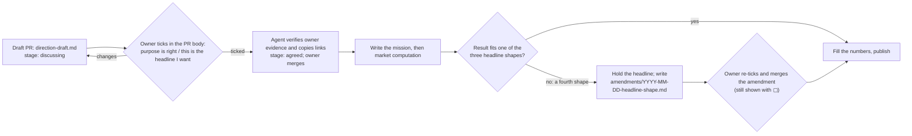

# Direction drafts

A direction draft is the reviewable artifact between "an idea came up in conversation" and
"a mission is written". The owner reads it, confirms the purpose and the shape of the
answer, and only then does market computation start. It exists because four things went
missing in the PR17 → PR61 → PR113 chain and could not be recovered afterwards:

| Gap                                    | What happened                                                                                                                                                           |
| -------------------------------------- | ----------------------------------------------------------------------------------------------------------------------------------------------------------------------- |
| The owner's purpose was not written    | The owner wants a stop-loss method; the studies answered "how many eventual doublers would a signal kill". Nothing said how many steps remained to the purpose.         |
| Title promised more than the main grid | The title named 2/3/5/10x while the main comparison fixed 2x (W6); the secondary multiples were not marked secondary.                                                   |
| Condition and outcome shared a word    | 1.6x (a look-back condition threshold) and 2x (a look-forward outcome target) were both "x" with different bases.                                                       |
| Questions and forks had no lifecycle   | "Pattern's extra contribution" was saved as "not evaluated"; why a direction was chosen was reconstructed after delivery. No question had an ID, an owner or a way out. |

The evidence for the cases is in [the examples](#worked-examples). Template:
[`templates/direction-draft.md`](templates/direction-draft.md). Skill:
`research-direction-draft` (Claude and Codex copies).

## Scope

New studies only. Existing `tasks/*` reports, `study.json` cards and PR113 are not rewritten;
the examples below are retrospective demonstrations. A study with a draft keeps the draft in
`tasks/<task-id>/direction-draft.md`. The file is the only record: the PR body collects the
owner's ticks, and the agent copies each one (with its link) into the file before merge.
The owner merges only after those confirmations; merge alone is not evidence of approval.
Discussion happens in a GitHub draft PR, readable on a phone. The optional fake report is a
desktop preview under `tasks/<task-id>/preview/index.html`, visibly labelled as a draft with
placeholder numbers. It is not registered in the dashboard. This page changes no study-card, report-kit
or dashboard contract; `study-card.v2` is unchanged (see
[study-presentation](study-presentation.md#study-cards-v2) for how a `not_evaluated` card may
point at a draft).

## Flow



| Role                           | Responsibility                                                                                                                                                                                                                                                                                       |
| ------------------------------ | ---------------------------------------------------------------------------------------------------------------------------------------------------------------------------------------------------------------------------------------------------------------------------------------------------- |
| Draft author (Codex or Claude) | Record the owner's purpose and steps remaining; log forks in ⑪ and turn "later" into ⑫ questions. Have a cold-reading subagent state the purpose, main comparison, headline form and primary/secondary boundary from the draft alone. Verify and copy owner confirmations.                           |
| Executing agent                | Before any market command, verify the agreed draft, owner evidence and merged direction PR. Before publishing, assess the actual result against the agreed shapes; hold any fourth shape for the owner. At closeout write delivery and verbatim purpose in the reports, preserving the frozen draft. |
| The owner                      | Confirm the purpose, tick the fake headline and the choices C, merge to agree.                                                                                                                                                                                                                       |

### GitHub discussion and confirmation

1. Create `direction-draft.md` from the template with `stage: discussing`. Inventory the
   predecessor reports and their open questions before proposing scope. Mark unavailable
   wording or evidence `待確認`; a retrospective example does not authorize a new study.
2. Open a **draft PR** and append the [direction discussion body](templates/direction-draft-pr.md)
   to the normal PR description. Link the rendered draft at the exact commit being discussed.
   The body exposes purpose, the three fake headlines, choices and predecessor dispositions
   directly on the phone; the optional desktop preview is supplementary.
3. The owner checks the purpose, headline and C choices in the PR body, or posts an explicit
   confirmation comment if editing the body is unavailable. The agent must verify who confirmed
   which revision, and record a comment permalink or the PR link plus confirming edit/revision
   in the PR record. An agent-created checkbox or a URL alone is not owner consent.
4. Copy the evidence links into `owner_purpose_confirmed`, `fake_headline_approved` and the
   checked ⑧ choices; set `stage: agreed` only when all are confirmed. Changes to purpose,
   scope or fake headlines invalidate the affected confirmation and go back to the owner.
   The owner decides when to leave draft and merge. Freeze the agreed file after merge.
5. Before opening a computation package, the executing agent reads that evidence again and
   records the agreed draft commit and confirmation links in the work package. The ordinary
   mission/preregistration and execution authorization still apply. The process PR itself
   and the direction approval do not authorize a market run.

### Hard gates and their limits

| Decision | Required behavior                                                                                    | Automatic evidence                                                                                                                                        | Human responsibility                                                                                                                                                                                                                                                                 |
| -------- | ---------------------------------------------------------------------------------------------------- | --------------------------------------------------------------------------------------------------------------------------------------------------------- | ------------------------------------------------------------------------------------------------------------------------------------------------------------------------------------------------------------------------------------------------------------------------------------ |
| D2       | No market computation before the owner confirms the fake headlines and purpose.                      | An agreed draft requires approval links and resolved choices. A task with repository-visible results, run receipts or formal reports must pass that gate. | The executing agent verifies the owner, approved revision, merged direction PR and run authority immediately before launching any market command. Tests cannot observe earlier executions or external/ignored results absent from CI.                                                |
| D3       | A result outside the three agreed shapes must go back to the owner before any headline is published. | Placeholder/number and title consistency checks catch some wording errors; they cannot classify the result's meaning.                                     | Before publishing report, card or headline, the executing agent records the shape and supporting main-cell evidence in the report's `## 頭條發布確認`; the reviewer checks it. For a fourth shape, both require the owner-confirmed, merged amendment. No self-approved relabelling. |
| D5       | Every unresolved predecessor question must be carried or explicitly declined with a reason.          | Exact question references, known question states and predecessor dispositions are checked. `closes` alone cannot bypass carrying an unresolved question.  | The draft author inventories actual predecessors and checks closing evidence; the reviewer verifies completeness before owner confirmation. Missing predecessors, old reports without drafts and semantic adequacy of reasons require manual inspection.                             |

Repository-visible output checks cover non-empty `results/` and `runs/`, `run_receipt.json`,
`run-receipt.json`, `report.md` and `web-report/index.html` within a task that has a draft.
Use `preview/index.html` for the fake report. Existing tasks without drafts are not retrofitted.
These checks are safeguards at review time, not an execution lock or proof of authorization.

## Draft contents

Front matter is YAML (the repository already depends on PyYAML). Tables stay in the body
because they read well on a phone and are parsed row by row.

| Key                                             | Meaning                                                                                                                                                                |
| ----------------------------------------------- | ---------------------------------------------------------------------------------------------------------------------------------------------------------------------- |
| `schema`, `task_id`, `stage`                    | `direction-draft.v1`; the task directory; `discussing` or `agreed`.                                                                                                    |
| `owner_purpose`, `owner_purpose_source`         | The owner's own words, one sentence, and where they said it. Never a paraphrase presented as a quote.                                                                  |
| `owner_purpose_confirmed`                       | `null` until the owner confirms; a link when `agreed`.                                                                                                                 |
| `fake_headline_approved`                        | `null` until the owner ticks "this is what I want"; a link when `agreed`.                                                                                              |
| `title`, `title_outcome_multiples`              | The title and the outcome multiples it promises.                                                                                                                       |
| `outcome_multiples`, `condition_thresholds`     | Outcome targets (`primary`, `secondary`) and look-back condition thresholds, declared apart so thresholds never count.                                                 |
| `title_outcome_terms`                           | Definitions of outcome words such as 大漲 or 飆股 when the title or card uses them.                                                                                    |
| `based_on`, `carries`, `closes`, `open_choices` | Predecessors; questions (`<task-id>#Q<n>`) carried or intended to close; owner choices C1… awaiting a tick. `closes` must also be carried and is not closing evidence. |

Body sections, fixed order, headings `## ①` … `## ⑫`:

| #   | Section                        | Content                                                                                                                                                      |
| --- | ------------------------------ | ------------------------------------------------------------------------------------------------------------------------------------------------------------ |
| ①   | Purpose and decisions          | Verbatim purpose; what the owner does if the answer holds / does not hold / cannot be told; numbered table of steps still missing (or "0 步" with a reason). |
| ②   | Fake headline                  | One `>` line per branch, numbers as `▢▢%`; then "□ 這就是我要的".                                                                                            |
| ③   | Report skeleton                | 3–5 main panels: sentence, chart, denominator, period, primary or secondary.                                                                                 |
| ④   | Condition vs outcome legend    | The fixed legend below plus a one-line plain definition for each term.                                                                                       |
| ⑤   | Predecessor → this → follow-up | Mermaid or table; whether the denominator is shared.                                                                                                         |
| ⑥   | Data                           | Shared-data IDs; whether the period was already seen.                                                                                                        |
| ⑦   | Not done / known traps         | Each "not done" that touches the purpose links to a Q in ⑫ or a step in ①.                                                                                   |
| ⑧   | Owner choices                  | `- [ ] C1 …` with what changes if chosen; `- [x]` plus a link once ticked.                                                                                   |
| ⑨   | Size limit                     | Work packages, longest computation.                                                                                                                          |
| ⑩   | Promises                       | One row per promise in the title or card (承諾, 主要／次要, 對應主格). Frozen with the draft; delivery is written in `report.md`, never here.                |
| ⑪   | Fork log                       | One row per fork, kept even when dropped.                                                                                                                    |
| ⑫   | Open questions                 | One row per question, with where it is stuck and how it closes.                                                                                              |

### Legend (fixed text in ④)

Condition numbers are **thresholds** with a stated base; outcome numbers are **targets** with
the price written out. "翻倍" always means outcome target 2x. Condition and outcome numbers carry
different small labels on the page. Every draft and report reuses the same 100-yuan example:

```text
           過去 ◀──────────── 今天 t0（起點 100 元）────────────▶ 未來
  【條件】往回看，用來挑股票                     【結果】往前看，要統計的事
  年均價 62.5 元 ──×1.6──▶ 100 元             100 元 ──×2──▶ 200 元（一年內曾收盤到）
  近一年低點 40 元 ──×2.5──▶ 100 元           100 元 ──×3──▶ 300 元 …
  寫法：「條件門檻 1.6 倍（相對年均價）」      寫法：「結果目標 2 倍（200 元）」
```

### Fork log (⑪) and open questions (⑫)

Columns of ⑪: `ID | 日期 | 提出者 | 分岔 | 結果 | 理由 | 來源 | 待解`.

- Proposer is 擁有者, Opus (or Claude when the model is not distinguished) or Codex. Result is
  採用, 放棄, 部分採用 or 不承接. The reason may not be empty.
- Source is a link, `對話 YYYY-MM-DD：「short quote」`, or `repo: path:line`. "Not recorded" is
  not a source; quote one sentence instead. This is the answer to "the owner could not remember
  why we went this way".
- While `stage: discussing`, date, proposer and source may say `待確認` (not found). At
  `agreed` any `待確認` fails, the same as the purpose gate. A fork dropped with "later" must
  become a question.
- Carrying a predecessor's question goes in `carries`, not a log row; only declining needs a
  row (result 不承接, with the `<task-id>#Q<n>` named in the fork text and a reason).

Columns of ⑫: `ID | 問題 | 提出於 | 卡在哪 | 關閉路徑 | 狀態` with state `open`, `carried → <task>`
or `closed by <task>`. A frozen draft is never edited. `closes` declares a planned answer,
not a delivered one: keep the reference in `carries` as well, then record the answer and
closing evidence in the later report's delivery table and `research-lineage.md`. A question
without verified closing evidence remains unresolved, including one inherited by a predecessor.
The next draft **must** carry it or log 不承接 with its exact `<task-id>#Q<n>` and a reason.
Do not confuse `#Q1` with `#Q10`. The conservative validator keeps inherited questions visible;
when declining to carry an already answered question, cite its closing evidence in ⑪.
A predecessor without a draft has no addressable draft questions: inspect its report/lineage,
copy unresolved questions into this draft's ⑫, and record carry or decline with reason in ⑪.

## Title and headline consistency

Principle: the title and card promise no more than the main comparison, and secondary
results are marked 次要. `scripts/tests/test_direction_drafts.py` implements this for drafts:

| Rule | Check                                                                                                                                                                                                                                                                                     |
| ---- | ----------------------------------------------------------------------------------------------------------------------------------------------------------------------------------------------------------------------------------------------------------------------------------------- |
| R1   | Extract outcome multiples from text (`N 倍`, lists with `／ / 、`, 一二兩三…十, 翻倍 = 2) after removing `condition_thresholds`. Ranges such as `2–10 倍` are rejected as ambiguous. Applies to `title`, same-folder `study.json` `question`/`answer`, and every ② headline.              |
| R1b  | 大漲 and 飆股 in the title or `question` need a definition in `title_outcome_terms`. The word list is short and known to be incomplete.                                                                                                                                                   |
| R2   | The title's extracted set equals `title_outcome_multiples`, which must be covered by `outcome_multiples`.                                                                                                                                                                                 |
| R3   | Extracted multiples must be primary, or sit inside one bracket that also says 次要 (a headline line may start with 次要) and be declared secondary.                                                                                                                                       |
| R4   | Every ⑩ row is 主要 or 次要; a 主要 row names a main cell; at least one row is 主要.                                                                                                                                                                                                      |
| R5   | At closeout (`agreed` plus `report.md`): `report.md` and `web-report/index.html` text contain `擁有者原話目的：` plus the verbatim `owner_purpose`; `report.md` has a `## 承諾 vs 交付` table with a non-empty 實際交付 for every ⑩ promise; the draft itself carries no 實際交付 column. |

Applied to PR113's real title, `…讓 2／3／5／10 倍機率下降？`, R3 fails (the main grid is 2x
only); the accepted form is `…讓 2 倍機率下降？（另附 3／5／10 倍，次要）`. PR61's "大漲" is
stopped by R1b. The "same bracket" test is deliberately crude; a bracketless secondary clause
fails and is worded into a bracket.

## Fake headline gate

Before any market computation, ② must hold one headline per outcome branch with every number as
`▢▢%` (no digits before `%`). The owner ticks "this is what I want". Only then is `stage` set
to `agreed` and the computation package opened. A headline that is a real percentage fails the
check. Both confirmation links, resolved choices and the manual D2 check above are mandatory;
a checked box copied by an agent is not sufficient on its own.

A **fourth shape** is a result that fits none of the three branches, for example the direction
reverses, only a secondary cell moves, one of two conditions holds, samples are too small, or the
signal is so common that "has signal" is almost everyone. The headline is held, and
`amendments/YYYY-MM-DD-headline-shape.md` names the shape, why three branches cannot hold it, and
the new fake headline (still `▢`). It changes presentation only, never the preregistered reading
of the main cell. The owner re-ticks in a draft PR containing only the amendment; the headline is
published only after the owner confirms and merges it. Until then the report, card and PR
description must hold the proposed public headline. In `report.md`'s `## 頭條發布確認`, record
the chosen shape, supporting result location, and the amendment/owner-confirmation links when
applicable. A reviewer checks this before publication. Semantic fit is a manual gate; passing
the wording validator is not proof that the result fits an agreed shape.

## From draft to mission and report

| Draft                                 | Goes to                                                                                                                                             |
| ------------------------------------- | --------------------------------------------------------------------------------------------------------------------------------------------------- |
| ①, ②, ④                               | The mission's plain summary links the draft rather than rewriting it; decisions cite `← C2` / `← L4`.                                               |
| ②, ③                                  | After the publication gate, promote the optional `preview/index.html` to `web-report/index.html`, replace placeholders and remove the draft banner. |
| ⑩                                     | A `## 承諾 vs 交付` table in `report.md` (columns 承諾, 實際交付; one row per ⑩ promise) (R5).                                                      |
| ⑪, ⑫, `based_on`, `carries`, `closes` | The author maintains `research-lineage.md` from these and verified delivery evidence; no generator is provided by this PR.                          |

### Report links and delivery records

For a new study, keep `tasks/<task-id>/research-lineage.md` beside its report. For each predecessor,
record its question, established answer/limits, role (direct baseline or method source), reused
definition/data, additional question, denominator/clock differences, source version and publication
status. Link it from `report.md` and the research index. A partial or unpublished report stays labelled;
a later rerun does not become an earlier study's design basis. Missing sources stay unknown.

Use the existing report-link conventions without adding fields to `study-card.v2`:

- In HTML, link a readable predecessor with
  `<a data-related-report="<prior-task-id>" href="../../<prior-task-id>/web-report/index.html">…</a>`.
  Keep the real relative `href` for standalone reading. Dashboard-aware navigation uses the
  existing `rk:navigate` integration; the data attribute alone does not implement navigation.
- In the report's JSON-LD `Report`, list actual dependencies under `isBasedOn`, with
  `identifier`, `name`, `description` (role and limits) and stable `url`. Link the lineage record
  using `citation: "../research-lineage.md"`. Future follow-ups are navigation links, not bases.
- Do not use preview ports, another session's worktree, or a pending report as a published source.
  When a web report is unavailable, link its stable mission/report record and label the status.
- In `report.md`, use each ⑩ promise verbatim as the `承諾` key. `實際交付` links to delivered
  evidence; an undelivered promise says `未交付` and links to its ⑫ question or a later amendment.
  Keep the original owner purpose verbatim in both report forms. None of these records changes
  the frozen draft, stored results, source pins or historical missions.

Before closeout, the reviewer must follow every delivery/evidence or unanswered-question link
and compare the claim with its source. R5 checks the table's coverage and non-empty cells, not
the truth of delivery, link availability or adequacy of an answer. Passing it cannot replace
this review or owner acceptance.

This aligns with the lineage conventions in the PR113/PR138 report work. It does not claim
their presentation has been accepted or modify those studies. Dashboard direction labels remain
a separate follow-up after the UX branch merges (D6).

## Worked examples

Both are retrospective demonstrations, validated by the same test as real drafts. They do not
edit PR61, PR87/91 or PR113. Dates, proposers and sources not found in the decision chain are
marked `待確認`; the owner's exact words were not recovered, so both drafts carry a summary and
stay `discussing` (they cannot be `agreed` until the owner supplies words and ticks).

| Card | Study                                               | File                                                                       | What it shows                                                                                                           |
| ---- | --------------------------------------------------- | -------------------------------------------------------------------------- | ----------------------------------------------------------------------------------------------------------------------- |
| A    | PR61 `20261021-momentum-only-doubling`              | [example A](examples/direction-draft-20261021-momentum-only-doubling.md)   | The pattern-contribution question carried as Q1 with its blocker instead of one line "not evaluated".                   |
| B    | PR87/91 → PR113 `20261024-strength-weakening-flags` | [example B](examples/direction-draft-20261024-strength-weakening-flags.md) | Steps 3–5 to a stop-loss method left visible; the corrected title; the owner-asked 2/5/10x versus the 3x that appeared. |

Recorded gaps in the chain (the examples keep them as written, not as facts):

- The sentence "does not mean patterns are useless" was not found in PR113 files; it is not
  quoted. That the owner said "2x may be unrelated to patterns" has no evidence and is not
  attributed.
- Who decided PR61 would include higher multiples is not found; PR17's reason for 2x only is
  not found.
- "Do not approve stop-loss rules" was drafted by Claude and released with W1–W10, not
  confirmed word by word; "5/10x only secondary" in W6 was likewise not confirmed separately.
- The market-state comparison raised on 2026-10-05/12 is absent from W1–W10; whether it was
  excluded on purpose is not recorded.
- Whether the 6.1 GB of raw PR17 input was kept after cleanup was not found.
