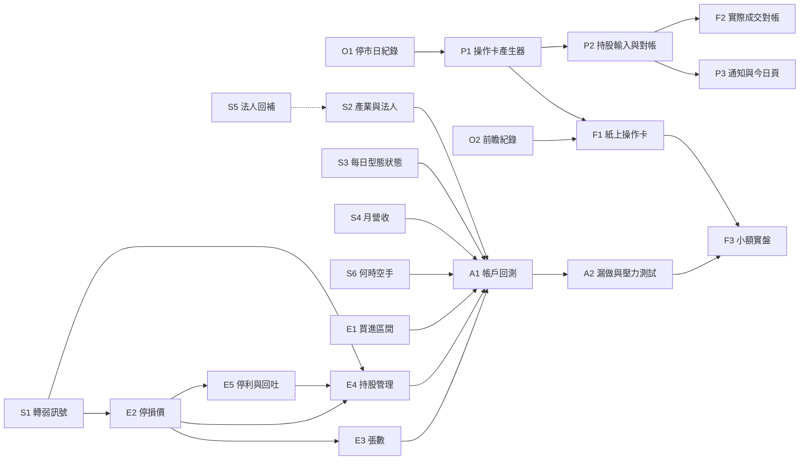

# 長期研究路線圖：從飆股研究到每天的操作卡

2026-10-27 草案。這份文件把目前的研究、PR 與 issue 狀態，整理成走到最終產品的工作包，
供 Codex 依序接手。它是方向與順序，不是預註冊：每個會看到「之後漲跌結果」的工作包，仍要先寫
mission 並由 owner 合併，門檻在看結果前固定。owner 待決事項見[第 6 節](#owner-decisions)。

## 1. 一段話結論

- **選股訊號有線索，但還不是策略。** 強勢條件 CORE（收盤高於年線 60% 以上、且是一年低點的
  2.5 倍以上）半年翻倍 14.5%，全市場任一天 3.9%；但一年後「沒翻倍又收低」也較多
  （60.1% 對 45.1%）。兩年 5 倍的飆股，CORE 首次成立時中位數已漲 163%，之後到頂中位數
  還有 126%（[PR 61 報告](../../tasks/20261021-momentum-only-doubling/report.md)）。
- **K 線型態、法人、產業齊漲，目前都沒有答案。** 高過高／低不破低（HHHL）與對照組分不開；
  12 種型態的完整條件分析只完成 2 種；「強勢條件之外，型態多貢獻多少」因為每日型態狀態沒有
  做成共用資料而沒有評估。法人與產業的研究設計和程式已合併，還沒執行。
- **沒有任何「進場＋停損＋部位＋出場」組合在 2010 起的資料上驗證過。** 8–9 月那條帳戶研究線
  只用 2019 起資料、舊引擎；最好的可執行版本在 2024-01..2026-08 賺 +51.2%，同期買 0050 放著
  是 +215.5%（[可執行成交報告](../../tasks/20260908-executable-fills/report.md)）。
- **建議順序：** 先修資料與前瞻紀錄 → 補完選股訊號的三個問題 → 把「買進區間、停損價、張數」
  量成規則 → 200 萬／5 檔帳戶回測（必列 0050 與空手對照）→ 紙上操作 → 小額實盤。
  操作卡的產生程式可以**提早用暫定規則做出來**，邊研究邊替換規則，讓前瞻紀錄早點開始累積。

## 2. 最終產品：每天收盤後一張「明日操作卡」

操作卡是 owner 自己事先登記的規則跑出來的機械結果，不是個人化投資建議；下單與否由 owner
決定並自行執行。下面的價格與股票都是示意。

```text
10/28（三）操作卡        資料截至 10/27 收盤（已確認是最新交易日）
帳戶：現金 112 萬｜持股 3 檔｜空槽位 2｜目前總停損風險 4.1 萬（帳戶 2.0%）

[買進] 股票甲  理由：強勢條件成立＋當日漲停，未出現轉弱訊號
       可買區間 91.0–96.0（A–B）：盤前掛限價 96.0
       開盤高於 96.0 不追；開盤低於 91.0 取消，不買
       跌破 88.0（C，停損價）：訊號作廢，之後幾天也不買
       數量 2 張（約 19.2 萬；從 96.0 跌到 88.0 約虧 1.6 萬 = 帳戶 0.8%）
[賣出] 股票乙  理由：收盤跌破停損價 51.5
       明天開盤賣出 3 張
[續抱] 股票丙  停損價由 120.0 上移到 128.0
[不動作] 今天沒有其他符合條件的股票
```

| 卡片上的輸出                 | 要由哪個研究回答                        | 目前狀態                                                                                                                |
| ---------------------------- | --------------------------------------- | ----------------------------------------------------------------------------------------------------------------------- |
| 候選股（今天符合條件的）     | S1–S4：轉弱訊號、型態、法人／產業、營收 | 強勢條件完成；轉弱訊號程式已合併、mission 待合併；其他未執行                                                            |
| 買進區間 A–B、「開太高不追」 | E1：訊號隔天的跳空與成交                | 沒有研究；舊研究只量過「突破隔天開盤平均跳高 0.69%」                                                                    |
| 不買／停損價 C               | E2：停損定義與錯殺代價（接 S1）         | 8–9 月停損研究只有 2019 起資料                                                                                          |
| 停利、停損價上移             | E5：漲到哪裡、何時回吐                  | 舊回吐停利研究為負面，只有 2019 起資料                                                                                  |
| 張數與金額                   | E3：每筆可承受的虧損 ÷（買價 − C）      | 等風險部位機制有效但未過關，只有 2019 起資料                                                                            |
| 持股「續抱／賣出／換股」     | E4：出場與換股規則                      | 換股、最低持有期在舊研究為負面；[H05](../../tasks/20261005-relative-strength-holding/report.md) 接線完成、市場評估 0 次 |
| 現金比例、何時空手           | S6：市場環境                            | 舊研究 29 種疊加 0 種通過，只有 2019 起                                                                                 |
| 資料新鮮度保護               | O1、P1                                  | 沒有：資料不是最新交易日時，卡片必須不出、只發警告；颱風停市（例如 10-23）不在休市表，必須算成非交易日，不能誤報缺資料  |

**owner 每天的輸入：** 目前持股（代號、股數、成本、買進日）與昨天實際成交。產生器比對昨天的卡片，
列出「卡片要買但沒買」「已賣出」等差異，並依實際持股與現金重新計算，不補做過期委託
（[owner contract 的漏做後恢復](research-owner-contract.md)）。

**時間軸：** producer 18:00 開始更新、共用資料約 20:30 → 卡片約 21:00 → 隔天 09:00 前看卡下單。
買進區間與停損價都能寫成預約限價單或觸價單，不需要盤中盯盤；券商實際支援哪些單別仍須確認。

**通知通道之後再定。** 先把卡片存成檔案並放到 dashboard 的「今日」頁；Gmail 寄給自己、
Notion、手機推播等等產品成形後再選。

## 3. owner 問的三件事，現在的狀態

| 問題            | 做到哪裡                                                                                                                                                                                                                                                                  | 還缺什麼                                                                                |
| --------------- | ------------------------------------------------------------------------------------------------------------------------------------------------------------------------------------------------------------------------------------------------------------------------- | --------------------------------------------------------------------------------------- |
| 飆股 × K 線     | HHHL v1 突破 126 日翻倍 7.86% 對照 7.88%；v4 8.49% 對照 8.86%（[v4 報告](../../tasks/20261010-hhhl-v4-probability/report.md)）。12 種型態第一題完成；條件分析只完成 B1、H1，其餘 10 種的 v6 續跑正在進行（[交接](../../tasks/20261013-pattern-scan/handoff-q2-q6-v5.md)） | 每日型態狀態做成共用資料，才能回答「強勢條件之外，型態多貢獻多少」（S3）                |
| 飆股 × 法人     | 設計與程式已合併（[#92](https://github.com/TaiwanCCyoyo/stock-research/pull/92)、[#94](https://github.com/TaiwanCCyoyo/stock-research/pull/94)，[交接](../../tasks/20261024-tenbagger-drivers/codex-handoff.md)），還沒執行                                               | 法人資料只從 2019-01-02 起：法人那組樣本小，兩年期只能用到 2024-09 以前的起點（S2、S5） |
| 飆股 × 產業齊漲 | 同一份研究，同樣還沒執行                                                                                                                                                                                                                                                  | 產業是現行分類、不是當時分類，報告須照實寫成限制                                        |

## 4. 舊 issue 與 PR 值不值得做

| 項目                                                                               | 判斷                    | 理由                                                                                                                                                                                                                |
| ---------------------------------------------------------------------------------- | ----------------------- | ------------------------------------------------------------------------------------------------------------------------------------------------------------------------------------------------------------------- |
| [PR #91](https://github.com/TaiwanCCyoyo/stock-research/pull/91) 轉弱訊號 mission  | 值得，請 owner 合併     | 程式（#93）已合併；mission 合併後就能執行，結果直接決定停損價 C 的候選                                                                                                                                              |
| [#50](https://github.com/TaiwanCCyoyo/stock-research/issues/50) 加速型態條件彙總   | 值得，但改以第 2 項為主 | `adjusted-daily-v1` 的 `daily-conditions.v1` 已有每日條件的原始數值；缺的是分組切點、跨股排名與**每日型態狀態**。後者同時解鎖 S3 與 PR 61 未評估的型態分解。第 1 項（控制組只算一次）只在 PR17 剩下的家族續跑時有用 |
| [#25](https://github.com/TaiwanCCyoyo/stock-research/issues/25) dashboard 展示盤點 | 值得，併進 P4           | 等操作卡格式確定後，一起決定 dashboard「今日」頁與研究明細頁要呈現什麼                                                                                                                                              |
| PR17 剩下 10 種型態的條件分析                                                      | 繼續目前的 v6 續跑      | 已在執行（10-27 時 B4 進度 19/20）；S3 完成後若更快，剩下的家族改走 S3 的路徑，結果須與已完成的 B1、H1 逐列相同                                                                                                     |

8–9 月的帳戶研究（停損、棘輪、回吐停利、等風險部位、最低持有期、換股、加碼、空手門檻、市場疊加、
延長持有）大多是負面或未過關，而且**全部只用 2019 起資料**。它們的機制結論仍有參考價值，例如
「連續虧損是 20 檔不同股票，冷卻期擋不到」「快速小賠是機制本身」
（[虧損解剖](../../tasks/20260906-loss-anatomy/report.md)）；但要當成規則依據前，須在 2010 起資料與
目前引擎上重新量，不改寫舊報告。

<a id="work-packages"></a>

## 5. 工作包

### 依賴關係



### 階段 0：營運修復（現在就做，可平行）

| ID  | 工作                 | 事實與完成條件                                                                                                                                                                                                                                                                                                                                                                                                                                                                                                                                                                           |
| --- | -------------------- | ---------------------------------------------------------------------------------------------------------------------------------------------------------------------------------------------------------------------------------------------------------------------------------------------------------------------------------------------------------------------------------------------------------------------------------------------------------------------------------------------------------------------------------------------------------------------------------------- |
| O1  | 臨時停市日的紀錄     | 10-27 查到 `official_daily_price` 與 `institutional_daily` 都停在 10-22，這是正常的：10-23（週五）颱風停市（owner 2026-10-27 確認），10-26 是光復節補假（TWSE 休市表有列）。但颱風停市不會出現在 TWSE 休市表，producer 現在只把它記成 `partial` 的空回應（與週末、補假日的回應相同），沒有任何地方寫明「這天停市」，之後的程式分不出停市和抓取失敗。完成：用可驗證的來源記錄臨時停市日（例如停市公告，或全市場回應都為空時再確認），讓 producer、共用資料與操作卡產生器都能分辨「停市」和「最新交易日沒資料」，真的缺資料時明確失敗或警告。producer 修改走 submodule PR（第 6 節決定 3） |
| O2  | 前瞻紀錄的中斷與起算 | `forward-log/` 沒有 `cohort.json`，12 個月確認樣本**還沒開始**；`attempts.jsonl` 只有 1 列（10-22，late）。10-26 21:00 排程以 `0xC000013A`（被中斷）結束，沒有寫紀錄，違反「每次執行恰好一列」。完成：中斷也留下紀錄（或下次啟動時補記上次未完成），並報告第一個準時日何時可能出現                                                                                                                                                                                                                                                                                                       |

### 階段 1：選股訊號補完（2010 起的描述性研究）

| ID  | 工作                              | 前置                        | 重用                                                                                                                            | 回答什麼                                                                                                                  |
| --- | --------------------------------- | --------------------------- | ------------------------------------------------------------------------------------------------------------------------------- | ------------------------------------------------------------------------------------------------------------------------- |
| S1  | 轉弱訊號執行與報告（工作包 C、D） | owner 合併 #91              | [交接](../../tasks/20261024-strength-weakening-flags/codex-handoff.md)                                                          | 強勢成立後幾週出現哪個轉弱訊號，之後翻倍率明顯下降；提早放棄會錯殺多少                                                    |
| S2  | 產業齊漲＋法人第一步（工作包 C）  | 已滿足                      | [交接](../../tasks/20261024-tenbagger-drivers/codex-handoff.md)                                                                 | 10 倍、5 倍股在起漲、漲 1 倍、漲 2 倍時，產業熱度、成交規模、法人買進是否不同於漲到 2–5 倍就停的股票；第二步由 owner 決定 |
| S3  | 每日型態狀態共用資料＋型態分解    | 無（與 PR17 v6 續跑不衝突） | #50 第 2 項、`daily-conditions.v1`、PR17 12 個 detector                                                                         | 新共用家族：每股每日各型態是否成立（只用當日可知資訊）；再補 PR 61 的 `not_evaluated`：強勢條件之外，型態多貢獻多少       |
| S4  | 月營收動能（新）                  | 無                          | `monthly_revenue`（2013-01 起，含 `announcement_at`）                                                                           | 營收年增率轉正／加速／創新高，對強勢事件與 10 倍股是否有額外分辨力；條件只能用公告後的資料，不能用營收月份當可知日        |
| S5  | 法人資料往前回補（資料）          | 第 6 節決定 3               | `skill: market-data-acquisition`                                                                                                | 先探測 TWSE T86 與 TPEx 的歷史起點與欄位，再決定回補範圍；讓法人研究盡量符合 2010 起的規則                                |
| S6  | 何時空手（市場環境）              | 無                          | [0050 背景](../../tasks/20261005-market-context-handoff/report.md)、[舊疊加研究](../../tasks/20260823-regime-overlay/report.md) | 2010 起有 2011、2015、2018、2022 多段下跌（舊研究只有一個空頭年）；強勢條件的翻倍率與虧損率是否隨市場狀態明顯改變         |

### 階段 2：把訊號變成可下單的規則（量測，不是帳戶回測）

| ID  | 工作                 | 前置       | 重用                                                                                                                                  | 回答什麼                                                                                                                                                   |
| --- | -------------------- | ---------- | ------------------------------------------------------------------------------------------------------------------------------------- | ---------------------------------------------------------------------------------------------------------------------------------------------------------- |
| E1  | 買進區間 A–B         | 無         | [可執行成交](../../tasks/20260908-executable-fills/report.md)的跳空量測                                                               | 訊號隔天開盤／最高／最低相對收盤的分布；「開盤高於 B 不追」在不同 B 下的成交率、錯過的飆股比例（最強的是不是跳最高）；漲停鎖死買不到的比例；用 2010 起資料 |
| E2  | 停損價 C 與錯殺代價  | S1         | S1 時鐘、[停損隔離](../../tasks/20260821-stop-mechanism-isolation/report.md)、[虧損解剖](../../tasks/20260906-loss-anatomy/report.md) | 候選 C（已確認低點、MA20、ATR 倍數、型態支撐）：買進後最大不利幅度的分布、被洗出後仍翻倍的比例、每筆停損虧損的大小                                         |
| E3  | 張數與金額           | E2         | [等風險部位](../../tasks/20260906-equal-risk-sizing/report.md)                                                                        | 「每筆可承受虧損 ÷（買價 − C）」與「每檔固定 40 萬」比較；整張與零股比例；不超過當日成交金額某比例的流動性上限                                             |
| E4  | 持股續抱／賣出／換股 | S1、E2、E5 | [換股](../../tasks/20260904-swap-rule/report.md)、[最低持有期](../../tasks/20260905-min-hold/report.md)、H05 政策                     | 持有中的股票何時讓位給新候選；停損價怎麼上移；在 2010 起資料上重量舊研究的機制，不改寫舊結論                                                               |
| E5  | 停利與回吐           | E2         | [回吐停利](../../tasks/20260905-wide-giveback/report.md)、[延長持有](../../tasks/20260826-runner-retention/report.md)、S1 時鐘        | CORE、LEAD_B1 事件之後的最大漲幅與到頂天數、從高點回吐多少、翻倍後又跌回買價以下的比例；「抱住飆股」與「保住獲利」之間的取捨，供 E4 與 A1 選停利規則       |

### 階段 3：帳戶回測（200 萬、最多 5 檔）

| ID  | 工作           | 前置             | 完成條件                                                                                                                                                                             |
| --- | -------------- | ---------------- | ------------------------------------------------------------------------------------------------------------------------------------------------------------------------------------ |
| A1  | 組裝並回測     | 階段 1、2 有線索 | 1–3 套事先登記的完整規則，在 H05 引擎、2010 起、隔日開盤成交、完整成本、整張／零股下回測。必列：同期 0050 買進持有、全現金、非命中侵蝕、淨值回撤、水下時間、週轉、零股比例、委託負擔 |
| A2  | 漏做與壓力測試 | A1               | 依 owner contract：漏做後依最新資訊恢復、移除最佳 1／3 筆、20%／3 日較重情境；對應方式在測試前固定                                                                                   |

### 階段 4：前瞻驗證（只有這段是還沒看過的資料）

| ID  | 工作         | 前置        | 完成條件                                                                                                                                                                                                                                                                               |
| --- | ------------ | ----------- | -------------------------------------------------------------------------------------------------------------------------------------------------------------------------------------------------------------------------------------------------------------------------------------- |
| F1  | 紙上操作卡   | O2、P1      | 每個交易日產生卡片並以 no-replace 保存，規則版本寫在卡上；規則更新時換新版本、舊卡保留。之後對照隔天實際價格算「本來會不會成交」。**規則只能依階段 1–3 的歷史研究修改，不能看前瞻結果調整**；F1 的 mission 事先固定評估前可看的內容（只有成交與營運計數，同 PR 61 前瞻紀錄）與何時評估 |
| F2  | 實際成交對帳 | P2          | 記錄 owner 實際下的單與成交，和卡片比較                                                                                                                                                                                                                                                |
| F3  | 小額實盤     | A2、F1 數月 | 先 1 個槽位，再依前瞻結果擴大；由 owner 決定                                                                                                                                                                                                                                           |

### 階段 5：產品

| ID  | 工作                    | 前置 | 完成條件                                                                                                                                  |
| --- | ----------------------- | ---- | ----------------------------------------------------------------------------------------------------------------------------------------- |
| P1  | 操作卡產生器            | O1   | `research_core/` 一個純函式模組＋`scripts/` 薄入口；先用暫定規則（例如強勢條件＋暫定 A–B／C／張數），資料不是最新交易日就不出卡、只出警告 |
| P2  | 持股輸入與對帳          | P1   | 固定格式的持股檔（代號、股數、成本、買進日）；與昨天卡片比對，列出差異                                                                    |
| P3  | 通知與 dashboard 今日頁 | P2   | 先做 dashboard 今日頁與卡片歷史（併 #25）；通知通道另與 owner 討論                                                                        |
| P4  | 持股事件提醒            | P2   | 持股的除權息、停牌等提醒；處置股／注意股目前 producer 沒有資料，需要時另開資料工作                                                        |

<a id="owner-decisions"></a>

## 6. 需要 owner 決定的事

1. **合併 PR #91。** 合併後轉弱訊號研究就能執行，它決定停損價 C 有哪些候選。
2. **紙上操作卡要不要現在就開始記（建議：要）。** 規則還是暫定的，但每晚一個月開始，就少一個月
   沒看過的資料；之後規則改了就換版本，舊卡留著。
3. **producer 修改與法人回補可以開 producer PR 嗎。** O1 的修復與 S5 的回補都要改 producer；
   這個 repo 尚未確認可以直接對 producer 開 PR。
4. **可接受的虧損上限（之後再定）。** 「反覆小賠累積到多少要停」只在 A1 之後的最終驗收需要，
   現在不用決定。

**已依技術預設決定（owner 可推翻）：** 帳戶報告一律並列同期 0050 買進持有與全現金，但不當淘汰門檻；
研究一律從 2010-01-04 開始，資料起點較晚的（法人 2019、營收 2013）只在覆蓋期內計算並寫明損失；
操作卡先存檔與 dashboard，通知通道之後再選。

## 7. 給 Codex 的共同規則

- 每個工作包一個 PR，從最新 `origin/main` 開分支，使用 `.worktrees/` 下的 worktree。
- 會看到之後漲跌結果（標籤）的工作包先交 mission，由 owner 合併後才執行；只建特徵或修資料的
  （S3 的共用資料、O1、O2、P1）不需要。沿用 PR 61 的母體、標籤、bootstrap 與
  `count_cube_v1`，門檻在看結果前固定，第一步的結果不得拿來改第二步的門檻。
- 不改寫、不刪除既有資料與結果；PR 61、PR17、8–9 月研究的程式、結果與收據一個位元組都不改，
  需要不同行為就加新版本模組。
- 研究讀 producer 一律唯讀（O1、S5 的 producer 修改走 submodule 流程）；平日 18:00–18:45 與任何 `StockProject-*` 執行中不讀（`assert_producer_idle()`）。
- 長時間計算用 `research_core/scratch_runs.py`；跨日就 hold 共用世代，完成後 release。
- 只終止自己啟動的 PID，不用 `taskkill /IM python.exe`；不碰 PR17 v6 續跑中的程序與 hold。
- 除了 O2，不碰 PR 61 的前瞻紀錄與 `StockResearch-MomentumForwardLog` 排程。
- 網站上看得到的文字不出現版本、雜湊、task ID、「快照」「世代」等字眼。
- 完成的研究依[研究總覽的收尾條件](research-program.md#收尾條件)交付 web-report、`study.json` 與共用資料登錄。
