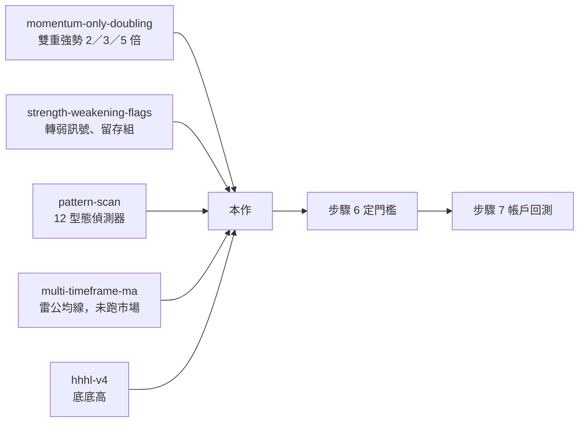

# 方向草稿：哪些型態組合與停損，能多抓到 2／3／5 倍股又少賠？

> 這是方向草稿，不是研究結果。下列頭條的數字全部用 `▢` 佔位。流程見 [direction-drafts.md](../../docs/en/direction-drafts.md)。

GitHub draft PR 保留方向與確認紀錄，搭配 [PR 描述模板](../../docs/en/templates/direction-draft-pr.md)。
擁有者確認原話、假頭條與選擇前不得開始市場計算；代理核對確認者與版本後才回填連結。
細節（每個方法的定義卡、網路查證來源、既有數字）放在同資料夾的 [definition-cards.md](definition-cards.md)。

## ① 擁有者原話目的與決定

原話：「最終，我會想要找到盡量有高倍機率的型態，型態也可以搭配，例如多重強勢……以及找到停損不會排掉過多會變成高倍股的停損方法，卻又不會讓停損要賠太多，停損也可以多個方法搭配，也可以有買回機制」（與 front matter 的 `owner_purpose` 相同）。

起因（對話 2026-11-04，擁有者）：懷疑雙重強勢停損很難做，而一年 2 倍的比例只有約兩成。

| 若答案…    | 擁有者能做的決定                                                                                                              |
| ---------- | ----------------------------------------------------------------------------------------------------------------------------- |
| 成立：     | 從表 A 挑出高倍比例明顯高於基準的進場組合，搭配表 B／C 中錯殺少、賠得少的停損與買回，進入步驟 6（定門檻）與步驟 7（帳戶回測） |
| 不成立：   | 型態路線不再加碼；改看法人、月營收等其他訊號，或接受「強勢股只能用寬停損」並在帳戶回測中按此配置資金                          |
| 分不出來： | 不進帳戶回測；擴大樣本（例如序列條件放寬、合併同族型態）或改用前瞻紀錄累積新期間，再判斷                                      |

離最終目的還差哪幾步：

| 步驟 | 內容                                                                         | 本研究做不做                                            |
| ---- | ---------------------------------------------------------------------------- | ------------------------------------------------------- |
| 1    | 每個方法的定義卡（擁有者確認）；每日型態狀態共用資料                         | 做（前置，WP0）                                         |
| 2    | 單一條件（型態、均線、雙均線、老雷構造／2B／W 底、法人）→ 2／3／5 倍結果等級 | 做（WP1）                                               |
| 3    | 兩兩同日組合、先 A 後 B 序列、搭配法人；先排除必然或不可能同時成立的組合     | 做（WP2）                                               |
| 4    | 各停損：錯殺多少高倍股、觸發時平均賠多少、留存組高倍率                       | 做（WP3，可先用雙重強勢）                               |
| 5    | 停損後買回：救回多少高倍股、多付多少價差                                     | 做（WP4）                                               |
| 6    | 定義加權方式與門檻，挑出「進場組合＋停損＋買回」候選                         | 不做（需本研究數據；在碰驗證期與帳戶回測前寫死，見 Q3） |
| 7    | 帳戶回測：500 萬以內、最多 5 檔、不過度換股                                  | 不做（另立研究，見 Q7）                                 |
| 8    | 紙上操作卡、小額實盤                                                         | 不做（路線圖 F1、F3）                                   |

## ② 假頭條（按結果分支）

> 成立：有 ▢▢ 個型態組合讓 2／3／5 倍比例明顯高於雙重強勢與全市場基準；最好的停損加買回保留 ▢▢% 高倍股，觸發時平均只賠 ▢▢%。
> 不成立：沒有型態組合在雙重強勢之外明顯多抓到 2／3／5 倍股；每種停損不是錯殺超過 ▢▢% 高倍股，就是平均賠超過 ▢▢%。
> 分不出來：型態組合與基準的差距落在不確定區間內，或可判定樣本只有 ▢▢%，無法區分。

□ 這就是我要的（擁有者在 PR body 勾選；agreed 前抄入 `fake_headline_approved`）

若實際結果放不進三種形狀，必須先暫停頭條發布，用獨立 amendment PR 交給擁有者確認並
合併；不得自行換標籤。收尾在 `report.md` 的 `## 頭條發布確認` 記下形狀、結果證據與確認來源。

## ③ 報告骨架

| 面板          | 要說的話                                           | 圖                                                 | 分母                       | 期間                                | 主要／次要        |
| ------------- | -------------------------------------------------- | -------------------------------------------------- | -------------------------- | ----------------------------------- | ----------------- |
| P1 找高倍     | 哪些單一條件讓 2／3／5 倍變多                      | 每個條件一列，8 格結果等級堆疊條＋相對基準倍數     | 冷卻後進場事件             | 2010-01-04 起（法人 2012／2014 起） | 主要              |
| P2 停損取捨   | 每種停損錯殺多少高倍股、觸發時賠多少               | 散點：橫軸錯殺比例、縱軸觸發時平均賠，標出左下前緣 | 同 P1 的事件；先做雙重強勢 | 同上                                | 主要              |
| P3 買回       | 買回能把錯殺比例拉回多少、多付多少                 | P2 的點加箭頭（停損 → 停損＋買回）                 | 停損觸發事件               | 同上                                | 主要              |
| P4 組合與序列 | 先 A 後 B、同日 A+B 是否更好；哪些組合必然或不可能 | 相容性矩陣＋序列表                                 | A 或 B 成立的事件          | 同上                                | 次要              |
| P5 等值機率   | 把 8 格結果壓成一個比較刻度                        | 表格，列出失敗損失與期限假設                       | 同 P1                      | 同上                                | 次要（定義待 Q3） |

這次如何一起討論：

| 想釐清什麼                                            | 可以操作什麼                   | 操作後會看見什麼差別               | 選擇／備註回到哪裡                                |
| ----------------------------------------------------- | ------------------------------ | ---------------------------------- | ------------------------------------------------- |
| 三種結果分支各自讓擁有者做什麼決定                    | 切換「成立／不成立／分不出來」 | 該分支的假頭條、後續決定與限制     | 只是探索，不記成偏好                              |
| 先做停損還是先做型態、停損與買回候選、2B 寬嚴、驗證期 | C1–C11 各選一個選項，並寫備註  | 每個選項旁說明「選了報告會怎麼變」 | 匯出 Markdown／JSON 貼回 PR，代理核對版本後回填 ⑧ |
| 前作留下的問題怎麼處理                                | 展開 Q1–Q8                     | 卡在哪、怎麼關閉                   | 備註回填 ⑫                                        |

互動頁位置：Dashboard 研究頁「討論研究方向」→ `#direction/20261105-pattern-stops-high-multiples`，讀取同資料夾 `preview/direction-discussion.json`；model 的 `source.revision` 指向含本草稿的 commit，草稿一改就須重新核對並更新 model。操作與匯出都不代表確認。

## ④ 條件 vs 結果圖例與白話定義

```text
           過去 ◀──────────── 今天 t0（起點 100 元）────────────▶ 未來
  【條件】往回看，用來挑股票                     【結果】往前看，要統計的事
  年均價 62.5 元 ──×1.6──▶ 100 元             100 元 ──×2──▶ 200 元（一年內曾收盤到）
  近一年低點 40 元 ──×2.5──▶ 100 元           100 元 ──×3──▶ 300 元 …
  寫法：「條件門檻 1.6 倍（相對年均價）」      寫法：「結果目標 2 倍（200 元）」
```

條件一律叫門檻並寫明基準；結果一律叫目標並同時寫出價格。「翻倍」只能指結果目標 2 倍。

- 雙重強勢：條件門檻收盤 ≥ 年均價（MA240）1.6 倍，且 ≥ 一年最低收盤 2.5 倍（momentum-only-doubling 的 CORE）。
- 結果等級：兩年內最高收盤到達的結果目標（5 倍 500 元以上、3 倍 300 元、2 倍 200 元、未到 2 倍），每級再分「一年內到」與「第二年才到」；未到 2 倍再分兩年後收在起點之上或之下。共 8 格，每個事件只落一格，避免一年 2 倍與兩年 3 倍重複計算。
- 錯殺：最後到達某結果目標的事件中，在第一次到達結果目標 2 倍（200 元）之前就觸發停損的比例。
- 留存組：停損沒有觸發、仍持有的事件。
- 觸發時平均賠：停損觸發後次一交易日可成交價相對起點的損益，報中位數與較差的一成。
- 買回：停損後出現指定買回條件時重新進場；報救回的高倍事件比例與買回價相對賣出價的差。
- 定義卡：每個方法的來源說法、擁有者理解、程式定義、模糊點選項與正反例；未經擁有者確認一律標「代理」。

## ⑤ 前作 → 本作 → 後續



分母：沿用 momentum-only-doubling 的 1,942 檔普通股母體與 2010-01-04 起日曆（C11 可改）；改用冷卻後事件，因此筆數與該研究的每日口徑不同。

| 前作                     | 未解問題                                                                                                                | 本作處理                                          |
| ------------------------ | ----------------------------------------------------------------------------------------------------------------------- | ------------------------------------------------- |
| momentum-only-doubling   | 型態在強勢條件之外額外貢獻多少（`20261021-momentum-only-doubling#Q1`；報告 `decomposition_summary` 為 `not_evaluated`） | 承接（carries）                                   |
| strength-weakening-flags | 哪條停損規則的報酬與回撤優於持有不動（`20261024-strength-weakening-flags#Q3`）                                          | 承接（carries）：本作做描述統計，帳戶部分留步驟 7 |
| strength-weakening-flags | 轉弱效果在不同大盤狀態下是否不同（`20261024-strength-weakening-flags#Q4`）                                              | 不承接，見 ⑪ L18                                  |
| multi-timeframe-ma       | 整個研究 `not_evaluated`，mission 待擁有者合併                                                                          | 承接為本作 Q8                                     |

## ⑥ 會用到的資料

- 共用資料 `adjusted-daily-v1`：還原價、`technical-daily.v1`（SMA／EMA／ATR／布林／KD 所需欄位）、`daily-conditions.v1`、確認高低點（pivots）。
- 型態：`research_core/patterns/` 的 pattern-scan v1 偵測器；**每日型態狀態尚未做成共用資料**，WP0 先補（路線圖 S3）。
- 法人：producer `institutional_daily`（TWSE 2012-05-02 起、TPEx 2014-12-01 起）。
- 月營收：producer `monthly_revenue`（2013-01 起，含公告時點）。
- 待查：融資融券、處置／注意股公告、集保股權分散——有沒有、從何時起，WP0 查明（Q6）。
- 期間：2010-01-04 起全部已看過；股票分半或年代分組都不是未看過的驗證期（C8）。

## ⑦ 不做什麼與已知坑

- 不做帳戶回測、倉位與資金模擬（① 步驟 7、Q7）。
- 不定最終加權方式與門檻（① 步驟 6、Q3）。擁有者 2026-11-05 說明「加權後 > 70%」只是舉例。
- 不批准任何策略或停損規則。
- 不做盤中訊號，全部用收盤與次一交易日可成交價。
- 坑：停損不會提高「全部事件」中達到高倍的比例，只會提高「留存組」的比例。兩個分母都要報。strength-weakening-flags 已顯示，留存組差距有一大部分來自前 20 日已上漲；依第 20 日漲跌幅分層後，20 日線的差距由 −19.2 縮到 −4.8 個百分點。
- 坑：同股連續多日訊號不能當獨立樣本，改用冷卻後事件；組合與序列很多，候選要先登記（C8）。
- 坑：2B 定義曾與擁有者原意錯位（見 `docs/en/pattern-definitions.md`）。所有民間方法先過定義卡（C9）。
- 坑：雙重強勢與底部型態（例如 R2、老雷 2B）同一天幾乎不可能同時成立，只能做序列。
- 坑：兩年期結果只能從 2024-09 以前的起點判定。

## ⑧ 待擁有者決定

細節與來源見 [definition-cards.md](definition-cards.md)。

- [ ] C1 先後順序：WP3 停損先用雙重強勢做（不必等型態資料），WP0 型態資料平行做 —— 選了會讓報告怎麼變：最早回答「雙重強勢停損難不難做」，並用它決定 WP1 要找哪種型態。
- [ ] C2 結果等級用 ④ 的 8 格（含一年內 3 倍、5 倍）—— 選了會讓報告怎麼變：每個事件只算一次，年化時用實際到達天數。
- [ ] C3 停損候選：固定 7／10／15%；跌破 20 日、60 日線；季線連 3 日；老王分批（跌破 MA5 賣一半，再看 MA10 或 MA20）；雷公 20 日線抵扣拐頭向下；老雷底部構造被跌破；移動停利 15／20／25%；跌破已確認前低 —— 選了會讓報告怎麼變：P2 的點數與比較範圍。
- [ ] C4 買回候選：3 日內帶量站回月線；收盤站回出場前 20 日高點；老雷頂部構造被突破而作廢 —— 選了會讓報告怎麼變：P3 的箭頭。
- [ ] C5 老雷 2B「B 不是構造」：嚴格照構造規則與寬鬆（反彈不超過 N 根）兩版都算，先比較數量 —— 選了會讓報告怎麼變：2B 事件數與定義爭議可見。
- [ ] C6 老雷 2B「迅速」的根數：B→C 與 C 之後站回 A 各最多幾根（擁有者看盤經驗）—— 選了會讓報告怎麼變：2B 事件的範圍。
- [ ] C7 深度乖離前提（只出現在二手來源）：當選配變體，不當主定義 —— 選了會讓報告怎麼變：多一個 2B 變體。
- [ ] C8 驗證期：保留一段年份不看（例如 2017–2018），或一年期保留最後一段、兩年期只描述 —— 選了會讓報告怎麼變：哪些結果可當判定、哪些只是描述。
- [ ] C9 定義卡流程：型態類方法須附擁有者認可與不認可的正反例圖；均線類只勾參數 —— 選了會讓報告怎麼變：WP0 需要擁有者標註時間。
- [ ] C10 民間方法納入：均線糾結突破族（老王＋雷公＋民間合併）、KD 高檔鈍化、月營收創新高、法人連買；其他列為之後 —— 選了會讓報告怎麼變：P1 的列數。
- [ ] C11 母體與事件口徑：沿用 1,942 檔與 2010 起日曆、冷卻後事件 —— 選了會讓報告怎麼變：與 momentum-only-doubling 可直接對照。

## ⑨ 規模上限

- 工作包 5 個：WP0 定義卡與每日型態狀態共用資料、WP1 單一條件、WP2 組合與序列、WP3 停損、WP4 買回。
- 最長計算時間：待確認；依 AGENTS 規定，開跑前先量代表性階段的時間、記憶體與 I/O。
- 停損候選不超過 15 種，買回不超過 4 種；組合與序列候選在 WP2 開始前登記上限。

## ⑩ 承諾（交付對照在收尾 report.md）

| 承諾                                                                | 主要／次要 | 對應主格 |
| ------------------------------------------------------------------- | ---------- | -------- |
| 每個單一條件的 8 格結果等級（2／3／5 倍、一年／兩年）與相對基準倍數 | 主要       | P1       |
| 每種停損的錯殺比例、觸發時平均賠、留存比例與留存組高倍率            | 主要       | P2       |
| 每種買回救回的高倍比例與多付價差                                    | 主要       | P3       |
| 組合相容性矩陣與先 A 後 B 序列表                                    | 次要       | P4       |
| 等值機率比較刻度（定義依 Q3）                                       | 次要       | P5       |
| 10 倍結果目標的描述（次要）                                         | 次要       | P1 附錄  |

## ⑪ 討論分岔紀錄

| ID  | 日期       | 提出者 | 分岔                                                      | 結果     | 理由                                                          | 來源                                                                             | 待解 |
| --- | ---------- | ------ | --------------------------------------------------------- | -------- | ------------------------------------------------------------- | -------------------------------------------------------------------------------- | ---- |
| L1  | 2026-11-04 | 擁有者 | 雙重強勢停損難做，要量離各型態停損多遠、停損平均賠多少    | 採用     | 本研究起因                                                    | 對話 2026-11-04：「我強烈懷疑，他的停損很難做」                                  | 否   |
| L2  | 2026-11-04 | 擁有者 | 把一年 2 倍、兩年 3 倍、兩年 5 倍混成一個等值機率         | 部分採用 | 原式重複計算且未扣時間與虧損；改為 8 格互斥等級，最終加權延後 | 對話 2026-11-04：「混出一年 2 倍 + 2 年 3 倍 + 2年 5 倍的一個機率」              | Q3   |
| L3  | 2026-11-05 | 擁有者 | 兩年 3 倍權重 ×2、5 倍 ×4 太高（一年翻倍連兩年就是 4 倍） | 採用     | 改用實際到達天數年化                                          | 對話 2026-11-05：「3 倍 *2 會不會太多」                                          | 否   |
| L4  | 2026-11-04 | Codex  | 把「進場時停損距離」與「照訊號退出的實現損益」拆開        | 採用     | 兩者回答不同問題                                              | repo: .tmp/pattern-stops-equivalent-probability-discussion-20261104.md（未追蹤） | 否   |
| L5  | 2026-11-04 | Claude | 以「先到目標還是先到停損」的賽跑曲線為主軸                | 部分採用 | 簡化為 P2 的錯殺比例與觸發時損益，不做完整路徑模擬            | 對話 2026-11-04：「先到目標還是先到停損」                                        | 否   |
| L6  | 2026-11-05 | 擁有者 | 不做完整模擬，先用數據分析找各概念的機率關聯              | 採用     | 降低成本、先看方向                                            | 對話 2026-11-05：「我們還是先用數據分析方法」                                    | 否   |
| L7  | 2026-11-05 | 擁有者 | 加入一年內 3 倍                                           | 採用     | 多一格資訊                                                    | 對話 2026-11-05：「一年內 3 倍也可以做」                                         | 否   |
| L8  | 2026-11-05 | 擁有者 | 先符合 A、隔幾天符合 B 的序列，並思考 A+B 是否可能        | 採用     | 同日組合有必然與互斥的情況                                    | 對話 2026-11-05：「符合A型態，多少天後又符合B型態」                              | 否   |
| L9  | 2026-11-05 | 擁有者 | 查證老王均線停損與雷公雙均線（先前要求過但沒做）          | 採用     | 路線圖 S7 只做到合成資料；老王從未立項                        | 對話 2026-11-05：「之前都有說要你做」                                            | 否   |
| L10 | 2026-11-05 | 擁有者 | 找台股江湖方法，可能搭配後有用或在台股有用                | 採用     | 擴大候選，由資料判斷                                          | 對話 2026-11-05：「符合江湖傳說亂傳的方法」                                      | 否   |
| L11 | 2026-11-05 | 擁有者 | 2B 曾因沒先討論而定義錯位                                 | 採用     | 新增定義卡流程（C9）                                          | 對話 2026-11-05：「一開始就是沒討論」                                            | 否   |
| L12 | 2026-11-05 | 擁有者 | 依雷公本人說法做更精確的 2B，可重做研究                   | 採用     | 擁有者提供老雷〈頂底構造〉影片，字幕已讀                      | https://www.youtube.com/watch?v=IBuazwelwLg                                      | 否   |
| L13 | 2026-11-05 | Claude | 停損不會讓高倍機率變高                                    | 部分採用 | 擁有者指出留存組比例會變高；兩個分母都報                      | 對話 2026-11-05：「剩下來的最後變成飆股機率變高」                                | 否   |
| L14 | 2026-11-05 | 擁有者 | 加權後 > 70% 作為篩選門檻                                 | 部分採用 | 擁有者說明只是舉例；門檻待數據後、碰驗證期前定                | 對話 2026-11-05：「那是我隨便說一個數字」                                        | Q3   |
| L15 | 2026-11-05 | 擁有者 | 500 萬以內、最多 5 檔、不過度換股的帳戶回測               | 部分採用 | 列為步驟 7，不在本研究                                        | 對話 2026-11-05：「同時最多擁有 5 檔」                                           | Q7   |
| L16 | 2026-11-05 | Claude | 停損研究先用雙重強勢做，不等型態資料                      | 部分採用 | 待擁有者在 C1 決定                                            | 對話 2026-11-05：「③ 先做，只用雙重強勢」                                        | 否   |
| L17 | 2026-11-05 | 擁有者 | 這個討論也放到 Dashboard 幫助討論                         | 採用     | 依 discussion kit 提供同版本互動模型                          | 對話 2026-11-05：「這個討論也可以做到 dashboard 那邊幫助討論」                   | Q4   |
| L18 | 2026-11-05 | Claude | 不承接 20261024-strength-weakening-flags#Q4（大盤狀態）   | 不承接   | 與本研究目的無直接關係；路線圖 S6 另有「何時空手」            | repo: docs/en/research-roadmap.md（S6）                                          | 否   |

## ⑫ 待解問題

| ID                                   | 問題                                                                   | 提出於                                  | 卡在哪                        | 關閉路徑                                         | 狀態                                            |
| ------------------------------------ | ---------------------------------------------------------------------- | --------------------------------------- | ----------------------------- | ------------------------------------------------ | ----------------------------------------------- |
| 20261021-momentum-only-doubling#Q1   | 型態在強勢條件之外，額外貢獻多少？                                     | 20261021-momentum-only-doubling 的 L1   | 每日型態狀態未發布            | WP0 共用資料後，由 WP1／WP2 回答                 | carried → 20261105-pattern-stops-high-multiples |
| 20261024-strength-weakening-flags#Q3 | 哪條停損規則，報酬和回撤優於持有不動？                                 | 20261024-strength-weakening-flags 的 L2 | 本作只做描述統計              | 本作 WP3／WP4 給候選；帳戶部分由步驟 7（Q7）回答 | carried → 20261105-pattern-stops-high-multiples |
| Q3                                   | 等值機率的加權方式與挑選門檻                                           | L2                                      | 需要 WP3 的觸發時平均賠       | WP3 後由擁有者定義，碰驗證期與帳戶回測前寫死     | open                                            |
| Q4                                   | Dashboard 互動頁是否足以比較停損與買回候選，或需要另做候選比較視圖     | L17                                     | 目前 kit 只支援選項與分支切換 | 擁有者試用後在 PR 回覆                           | open                                            |
| Q5                                   | 雷公其他影片（關鍵性波動、雙均線、交易流程表）與「深度乖離」前提的原話 | L12                                     | 只有二手來源提到乖離          | 擁有者提供連結，或讀同頻道影片字幕               | open                                            |
| Q6                                   | 融資融券、處置公告、股權分散資料有沒有、從何時起                       | L10                                     | 未查                          | WP0 查 producer 資料                             | open                                            |
| Q7                                   | 500 萬以內、最多 5 檔的帳戶回測會遇到哪些問題                          | L15                                     | 需要步驟 6 的候選             | 另立研究                                         | open                                            |
| Q8                                   | 雷公多週期均線研究（multi-timeframe-ma）要併入本作還是另跑             | L9                                      | 該 mission 仍待擁有者合併     | 擁有者決定；併入時沿用其核心元件                 | open                                            |
